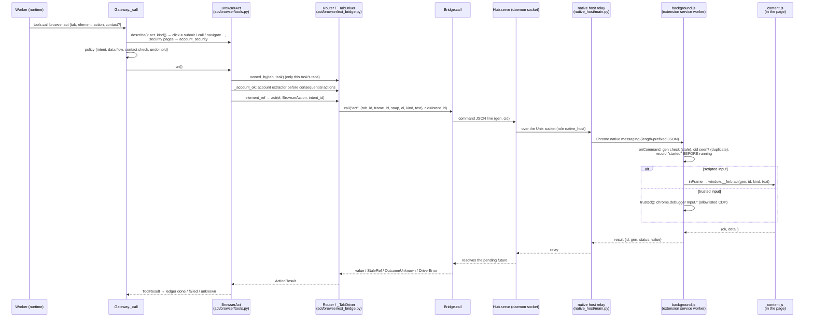

# Code tour

This tour walks through FERB's code in the order it runs. Line numbers are as of commit `18d119a` and will drift;
the function names are the stable anchors (`grep -n "def name"`). The design contract behind every piece is
[ARCHITECTURE.md](ARCHITECTURE.md); section numbers below (§) refer to it.

## 0. Before the flows: types, interfaces, registry

Read these three files first. Everything else is built on them.

**`ferb/core/types.py`** is pure data, with no I/O.
- `Identity` (line 9): `OWNER` (your Mac, browsers and shell; never credentials) vs `FERB` (FERB's own profile and
  accounts). Every task, token and capability carries one.
- `Task` (33) and `Outcome` (47): a unit of work and its typed result. Failures are values, never exceptions across
  worker boundaries.
- `Target` (112), `DataLabel` (122) and `ActionSpec` (130): what a tool call *would do*. That means its kind (send,
  submit, call, …), target (site, recipients, path, amount, contact), content and data labels. Policy decides on
  this, not on the tool's arguments.
- `ToolContext` (167) and `ToolResult` (182): what a capability receives and returns. `image` goes to the model only.
  `evidence` is for FERB's own checks only.
- `TrailEvent` (81) and `MemoryItem` (92): the activity trail and memory records.
- `PageElement` (238) and `PageSnapshot` (253): the browser's sanitized view of a page.

**`ferb/core/interfaces.py`** holds the seams, as `Protocol`s.
- `Clock` (16): `now()` for timestamps, `monotonic()` for timeouts. Tests use `FakeClock`.
- `AgentRuntime` (27): `start` / `events` / `continue_` / `cancel`. Codex and Claude implement it.
- `Capability` (36): `describe(args) -> ActionSpec` and `run(args, ctx) -> ToolResult`. Every tool is one.
- `BrowserDriver` (56) and `ComputerDriver` (69): the browser and Mac drivers.

**`ferb/registry.py`** turns drivers into tools.
- `Registry.add` (24) keys capabilities by name (`browser.act`, `mac.snapshot`, …).
- `build` (30) registers the always-present tools: files and time.
- `add_owner_browsers` (60), `add_identity_browser` (44), `add_mac` (75), `add_shell` (103), `add_trail` (88) and
  `add_time` (94) register the rest when the daemon has that driver.

A capability's `scopes` (for example `{"browser:act"}`) are what a plan must grant a worker. The gateway only lists
a tool to a worker whose token holds its scopes and identity (`Gateway.tools_for`).

---

## Flow 1: a chat request

`ferb chat` → daemon → supervisor → task graph → runtime → `ferb mcp` → gateway → policy engine → tool → sanitize → trace.

```mermaid
sequenceDiagram
    actor Owner
    participant CLI as ferb chat<br/>(cli/chat.py)
    participant Srv as Server<br/>(daemon/server.py)
    participant D as Daemon._chat_send<br/>(daemon/main.py)
    participant Sup as Supervisor.send<br/>(orchestrator/supervisor.py)
    participant RT as Runtime<br/>(runtimes/codex_exec.py)
    participant MCP as ferb mcp shim<br/>(cli/mcp.py)
    participant GW as Gateway._call<br/>(daemon/gateway.py)
    participant PE as PolicyEngine.evaluate<br/>(policy/engine.py)
    participant Cap as Capability.run<br/>(act/*/tools.py)
    participant DB as SpanStore / Ledger / Journal<br/>(SQLite)

    Owner->>CLI: types a request
    CLI->>Srv: stream "chat.send" (JSON-RPC over ~/.ferb/run/ferb.sock)
    Srv->>D: _stream → _chat_send
    D->>Sup: send(session_id, text)
    Sup->>Sup: mark() untrusted pastes, recall memory,<br/>availability(), environment()
    Sup->>RT: _supervise: planner run (mode="supervisor", no tools)
    RT-->>Sup: SupervisorOutcome (reply | clarify | plan)
    Sup->>Sup: dag.validate (+ up to 2 silent repairs),<br/>_intent → IntentRegistry.record (write-once)
    Sup->>Sup: run_tree → _execute (dag.ready) → _subtask
    Sup->>RT: WorkerRuns.run_worker: token (scopes, identity), tools_for, start
    RT->>MCP: spawns `ferb mcp` (FERB_RUN_TOKEN)
    MCP->>Srv: "tools.list" / "tools.call"
    Srv->>GW: Daemon._tools_call → Gateway.call
    GW->>GW: validate args, strip `why`, describe() → ActionSpec,<br/>taint labels, exploring / route change, contact check
    GW->>PE: evaluate(ActionRequest)
    PE-->>GW: allow | hold (undo) | ask | block
    GW->>DB: span start; ledger.intend (non-reversible)
    GW->>Cap: run(args, ToolContext)
    Cap-->>GW: ToolResult
    GW->>GW: redact(result), exposure / taint, footer
    GW->>DB: span finish, ledger mark done/failed
    GW-->>MCP: content + time footer (+ image)
    MCP-->>RT: tool result
    RT-->>Sup: worker's final JSON (typed Outcome)
    Sup->>Sup: _verify_all (code checks, verifier worker), _answer
    Sup-->>D: events: plan, subtask, outcome
    D-->>CLI: streamed events (+ bus events for this task)
    CLI-->>Owner: render(): FERB's answer, questions, countdowns
```

### Step by step

**The CLI**
- `ferb/cli/__init__.py:main` (15) parses the command. `chat` goes to `cli/chat.py:main_chat` (396) →
  `run_tty` (316).
- `run_tty` uses a prompt_toolkit line editor. Pastes arrive whole; `wrap_pastes` (85) marks them.
- `Chat.turn` (271) calls `Client.stream("chat.send", …)` (`cli/client.py:67`) and prints each event through
  `render` (97).
- Approval questions come back as `approval.requested` events. `Chat.answer_approval` (240) asks (`question`, 159)
  and replies with `chat.approve`.

**The daemon's server**
- `ferb/daemon/server.py:Server._connection` (133) checks the peer uid, then `_hello` (169) authenticates the role:
  the CLI, a runtime carrying a run token, or the native host.
- `_dispatch` (204) handles calls and `_stream` (230) handles streams.
- The daemon registers its methods in `Daemon.start` (`daemon/main.py:156`, method table around 185–207).

**One chat turn**
- `Daemon._chat_send` (`daemon/main.py:1774`) runs the turn as its own asyncio task. It merges the supervisor's
  events with bus events for the task (tool calls, approvals, undo countdowns, blocks).
- Closing chat detaches the stream but never cancels the task. Ctrl-C calls `task.stop` (`_task_stop`, 978).

**Planning**
- `Supervisor.send` (`orchestrator/supervisor.py:379`) starts the turn.
  - `mark` (`sanitize/untrusted.py:24`) separates your own words from pasted or quoted text (unless
    `[policy] pasted_text_is_data = false`).
  - `spelling.fix` (`policy/spelling.py:67`) reads a near-miss app name in your words as the one app it's close to
    ("salck" → Slack, said in the reply), or asks "Did you mean …?" when it's close to several.
  - `recall` / `recall_items` fetch memory.
  - `self.availability()` (the daemon's `_availability`, `daemon/main.py:1441`) builds the capability list the
    planner sees and the scopes validation allows.
  - `self.environment()` (`_environment`, 1326) picks routes for named services (`policy/services.py`) and adds
    the browser / profile you named (`_named_note`, 1385; `act/browser/profiles.py:named_in`, 146): use only
    that one, or say why it isn't connected yet.
- `_supervise` (488) builds the planner prompt. It comes from `prompts/supervisor.md` with `{capabilities}` filled in
  by `_system` (220), then the recent conversation, memory, environment and the message, with the time block last.
  It runs the orchestrator runtime in supervisor mode with no tools.
- `dag.tidy` (`orchestrator/dag.py:30`) first fixes what has one safe answer (a reader given acting scopes gets
  their read-only forms), with no model round-trip.
- `dag.validate` (`orchestrator/dag.py:44`) checks the plan: cycles, depth, fan-out, scopes against availability,
  reader rules, and that targets appear in your own words (`validate_intent`, 67; paths count by their folder
  names, `sanitize/untrusted.py:targets_in_own_words`). Problems go back to the model (`PLAN_REPAIRS`). If the plan
  is still invalid, you get the real reason in plain words (a name only in pasted text, a name FERB couldn't find,
  or "a problem on my side"), never the internals.
- `_intent` (585) turns the plan's intent into a `RequestIntent`, and `engine.intents.record` stores it write-once
  (`policy/intent.py`, `IntentRegistry`).

**Running the task graph**
- `run_tree` (603) creates the root task, subtasks (an actor's act scope brings its read scope via
  `rules.with_reads`), spans and persisted rows (`orchestrator/tree.py:TaskTree`).
- `_execute` (660) starts whatever `dag.ready` (125) returns, concurrently.
- `_subtask` (719) runs one subtask: readers get `_reader_context`, actors get `_actor_context` with the readers'
  typed fields wrapped as untrusted data.

**Workers**
- `WorkerRuns.run_worker` (`orchestrator/worker.py:82`) checks the guards, issues a run token (`daemon/auth.py`,
  `RunTokens.issue`, 76) and computes the tool list (`gateway.tools_for`).
- `make_runtime` is `Daemon._make_runtime` (1732). The prompt is `prompts/worker.md` plus context plus the time
  block.
- `CodexRuntime._cmd` (`runtimes/codex_exec.py:84`) runs `codex exec` in a read-only sandbox, with its native tools
  disabled and FERB's MCP server (`ferb mcp`) configured with the run token. `events` (137) parses the JSON stream.
  The tool list the model actually saw is checked on every run, and a violation unregisters the runtime.
- The Claude equivalent is `runtimes/claude_sdk.py:ClaudeRuntime`, with a localhost proxy (`runtimes/proxy.py`)
  that records tool names.

**The MCP shim**
- `cli/mcp.py:Shim.list_tools` (44) and `call_tool` (50) forward to the daemon's `tools.list` / `tools.call` with
  the run token.
- The daemon's `_tools_call` (1756) validates the session's grant and calls `Gateway.call`.

**The gateway** (`daemon/gateway.py:Gateway._call`, 108) checks, in order:
1. The tool is in this worker's list and the task is running.
2. The arguments validate. `why` is stripped from them (it's recorded in the span).
3. `cap.precheck` (e.g. `mac.click` purpose in messaging apps).
4. `cap.describe` gives the `ActionSpec`. Readers are limited to reversible kinds. Taint labels are added.
5. Exploring beyond the plan: a reversible look needs a `why`. An action outside the plan needs a `why` and becomes
   `_route_change` (278), after `engine.blocker` confirms policy wouldn't forbid it anyway.
6. The contact check for calls and sends (`_contact`, 330; `policy/contacts.py`).
7. `engine.evaluate`.
8. `ask` → `_await_owner` (388).
9. Jev's stricter-only check.
10. `hold` → `_wait_hold` (the undo window).
11. Resource locks → `_execute` (223).

**The policy engine** (`policy/engine.py:PolicyEngine.evaluate`, 67) runs a fixed order:
1. Stop.
2. Identity and scopes (`rules.check_identity`, 98; `check_scopes`, 116).
3. Exposure (`policy/exposure.py`).
4. Reversible kinds are allowed at this point.
5. Intent (`intent.check`, 104).
6. Data flow (`dataflow.check`, 10).
7. `autonomy.ask_reason` (14): the hard floor, flagged irreversible actions, surprising targets, careful mode.
8. Approvals (`policy/approvals.py`: scoped grants, or exact one-use grants for irreversible actions).
9. The undo window for sends, posts, replies and calls.

**Execution and the trace** (`Gateway._execute`, 223)
- For non-reversible actions, a ledger row is written *before* running (`orchestrator/ledger.py:Ledger.intend`, 47).
- Then `cap.run` runs. An exception marks the ledger `unknown`, to be reconciled later, never retried blindly.
- Read sources feed the taint and exposure trackers.
- The result is redacted (`sanitize/redact.py:Redactor.__call__`, 63).
- The span is finished (`store/spans.py:SpanStore.finish`, 36; spans are redacted before storage).
- The ledger is marked done or failed.
- The reply carries the time footer (`clock/context.py`).

**Finishing the task**
- `_verify_all` (836) checks each success condition in code where possible, and with a read-only verifier worker
  where it needs judgment.
- `_reconcile` (804) handles `unknown` outcomes.
- `_answer` (326) writes your answer from the readers' fields.
- `run_tree` journals `task.answer` / `task.outcome` and yields the final event.

`ferb trace [task]` renders a task and all its steps (`Daemon._trace`, 1837 → `SpanStore.tree`, 48, which also
collects the `<task>.<step>` tasks; `cli/admin.py:render_trace`, 66, shows each tool call's arguments and result,
with terminal output as plain text). No argument means the latest task; a short id works.

### Breakpoints (`ferb daemon run` in the foreground)

Run a separate daemon with its own home so the installed one keeps running:

```sh
FERB_HOME=/tmp/ferb-dev uv run ferb daemon run
FERB_HOME=/tmp/ferb-dev uv run ferb chat        # in another terminal
```

Put `breakpoint()` (or your IDE's breakpoint) at:
- `Daemon._chat_send`: every turn enters here.
- `Supervisor._supervise`: the exact planner prompt (`ctx`) and the parsed outcome.
- `dag.validate`: why a plan is rejected.
- `Supervisor._subtask` / `WorkerRuns.run_worker`: what each worker gets (scopes, tool list, context).
- `Gateway._call` right after `spec = cap.describe(args)`: every tool call's `ActionSpec`.
- `PolicyEngine.evaluate`: why something was allowed, held, asked or blocked.
- `Gateway._execute` before `cap.run`: the call about to happen.

Stopping in `pdb` pauses the whole event loop (one daemon thread). Runtimes keep running as subprocesses, so a long
pause can trip the 180 s stall watchdog or a runtime timeout. `ferb logs --tools --policy` shows the same decisions
without stopping anything.

---

## Flow 2: a browser action through the extension

A worker calls `browser.act` (your paired profile) or `ferb_browser.act` (FERB's own).



### Step by step

**The tool** (`act/browser/tools.py`)
- `BrowserAct` (294) takes `tab`, `element`, `action`, optional `trusted` and optional `contact`.
- `describe` classifies the action with `act_kind` (a click on a call button → `call`; a submit on an account or
  security page → `account_security`, which always asks).
- `_Base.run` (123) catches driver errors into `ToolResult` errors. `_run` checks tab ownership, the signed-in
  account (`_account_ok`, 154; `act/browser/accounts.py`) and the element reference.
- `BrowserOpen` / `BrowserSnapshot` follow the same pattern. Snapshots come back sanitized from the page and are
  sanitized again by the gateway (`act/browser/snapshot.py:for_model`).

**Choosing the profile** (`act/browser/resolver.py:Resolver`, 37)
- A profile you named wins.
- Otherwise, in order:
  1. a paired profile that already has the site open;
  2. the trail: the paired profile where *you* last used that site (FERB's own activity never counts);
  3. your default browser's last-used profile, if paired;
  4. ask.
- `Router.open_for` (`ext_bridge.py`, 554) refuses any profile other than the one you named for this request,
  then opens the tab in the background, in FERB's tab group.
- Waking a profile that isn't connected (`_TabDriver._connected`, 338): first `open -g` with
  `--no-startup-window` (`profiles.py:open_known_profile`, 98), which loads the profile and its extension without a
  window; only if that doesn't connect, a wake page, also through `open -g`. If a browser still ends up in front,
  `Daemon._put_owner_back` (407) gives you back your app. The extension creates a profile's first window minimized.
- `ferb browsers pair` (`Daemon._browsers_pair`, 1629) checks the extension is installed in that profile
  (`profiles.py:has_extension`, 116, from the profile's settings on disk); if not, `cli/admin.py:_guide_install`
  (146) walks you through Load unpacked and waits, then pairs.

**The bridge** (`act/browser/ext_bridge.py`)
- `Bridge.call` (76) sends a command with the connection's generation and a command id. It waits for the result and
  maps the status: `stale` (a reconnect happened; take a new snapshot), `duplicate` (never resent), or a timeout,
  which becomes `OutcomeUnknown` and is reconciled by the ledger, not retried.
- `Hub.serve` (167) is the daemon side of each extension connection. `_handle` (188) runs pairing (`pairing.py`:
  MAC-signed messages, replay protection), hellos and tab events.
- Tab events go to `on_tab`, which feeds the trail in flow 3.

**The native host** (`native_host/main.py:relay`, 42)
- Chrome starts `~/.ferb/bin/ferb-native-host`, which runs this relay with the caller extension's origin.
- It connects to the daemon socket as role `native_host`. `Server._hello` checks the origin against FERB's
  extension id (`auth.check_native_host`).
- It then copies messages both ways and exits when the daemon goes away, so the extension reconnects cleanly.

**The extension** (`extensions/chromium/`)
- `background.js:onDaemon` (87) handles `welcome`, `paired` and commands.
- `onCommand` (112) refuses a stale generation or a seen command id, records the id *before* running, and runs the
  op from `commands` (242).
- `commands.act` (308) runs either in the page (`inFrame` → `content.js:act`, 119) or as trusted input through
  `chrome.debugger` (`trusted`, 217; only an allowlisted set of CDP methods).
- `content.js` builds snapshots (`snapshot`, 77) with password fields masked in the page, and never types into
  secret fields.
- FERB's identity passwords are filled by the extension from a sealed value (`identity/seal.py`); the model never
  sees them.

### Breakpoints

- `BrowserAct.describe` / `act_kind`: how a click is classified.
- `Resolver` methods: which profile was chosen.
- `Bridge.call`: every command sent to a browser, and how it came back.
- `Hub._handle`: pairing and tab events.

To debug the extension, open the browser's extensions page and inspect the service worker, then set breakpoints in
`onCommand`.

With a foreground dev daemon, the extension still talks to the daemon that `~/.ferb/bin/ferb-native-host` points
at. The real tests show how to point it at a test daemon and restore it afterwards
(`tests/test_ext_real.py`, fixture `rd`). Use a spare browser profile for this.

---

## Flow 3: a trail event → daily summary → memory

```mermaid
sequenceDiagram
    participant Wt as Watcher<br/>(sense/watchers/*.py)
    participant S as Sense.emit<br/>(sense/manager.py)
    participant T as Trail.record<br/>(sense/trail.py)
    participant DB as SQLite (trail, journal,<br/>memory_items)
    participant Bus as bus (trail.event)
    participant L as Daemon._distill_loop (hourly)
    participant Di as Distiller<br/>(memory/distill.py)
    participant Sm as summary.build<br/>(memory/summary.py)
    participant RT as worker runtime (distill.md)
    participant M as Memory.propose<br/>(memory/items.py)

    Wt->>S: Observation(source, data)
    S->>T: record(o)
    T->>T: paused? → drop. exclusions? → drop (before anything is written)
    T->>T: redact(data); attribution.decide → actor (owner / ferb / unknown), task_id
    T->>DB: INSERT trail row (append-only)
    T->>Bus: publish trail.event
    T->>T: tag(e) (Jev, sampled, after persist)
    L->>Di: catch_up() → pending_days()
    Di->>Sm: write_summary(day): build(db, day) (code, no model)
    Sm-->>Di: DayEvidence (lines with handles E/C/P/F)
    Di->>DB: journal trail.day_summary (permanent)
    Di->>RT: _model(day, evidence): one run, typed output
    RT-->>Di: narrative + proposed items (each citing handles)
    Di->>Di: check(item, evidence): handles exist, E-only for observed,<br/>no FERB rows as the owner's habits
    Di->>M: propose(kind, subject, key, content, origin, sources)
    M->>DB: memory_items + sources (+ FTS); owner_stated active now,<br/>observed active after 3 separate days, inferred waits for confirm
    Di->>DB: purge(): raw trail rows past retention, only summarized days
```

### Step by step

**Watchers** (`sense/watchers/`)
- `AppFocusWatcher.run` (`app_focus.py:18`) polls the frontmost app (`base.py:focused_app`, 32, through
  Accessibility, because NSWorkspace goes stale in a daemon).
- The others: `windows.py` (titles; honors `[sense] window_titles`, skips browsers), `browser_tabs.py` (scripted
  tabs when no extension is connected), `files.py` (FSEvents, only `[sense] watch_folders`), `idle.py`,
  `app_installs.py`.
- `owner_input.py` is the event tap that tells your real input from FERB's marked input. The daemon uses it to pause
  FERB's foreground input while you're using yours, and to hear the push-to-talk key (Flow 5). `InputGuard` (100)
  is the filtering tap that's on only while FERB has an app in front (Flow 4).
- Browser tab events from paired extensions arrive through `Daemon._on_tab` (`daemon/main.py:613`).
- `Sense` (`sense/manager.py:14`) runs the watchers under `_guard` (44), which journals failures and shows them in
  doctor. `pause` / `resume` stop everything and persist a marker.

**Recording** (`sense/trail.py:Trail.record`, 94)
- The order is fixed: exclusions (`sense/exclusions.py`) → redact → id and actor (`Attribution.decide`, 62) →
  persist → publish → tag.
- `Attribution` knows FERB's own app switches, the files its tools touched, its tabs and its shells, so FERB's
  activity is never mistaken for yours (safety test 18).
- The table is append-only (a trigger), and every row has an actor.

**Daily summary and distillation** (`memory/distill.py:Distiller`)
- `Daemon._distill_loop` (715) calls `catch_up` (129) every hour.
- `run_day` (86) first writes the permanent summary by code (`write_summary`, 79 → `summary.build`, 57). A model
  failure can't lose a day, and the purge can't run before it.
- It then makes one model run (`_model`, 142; prompt `memory/distill.md`; the worker runtime; no tools).
- Proposals are checked against the evidence (`check`, 41), optionally filtered by Jev, and stored with
  `Memory.propose` (`memory/items.py:156`).
- `Memory._check` (187) enforces origins in code: FERB's rows never become your habits, and third-party content is
  never a preference or a fact about you.
- `catch_up` finally calls the purge (`Daemon._purge_trail`, 707 → `Trail.purge`), which refuses unsummarized days.

**Memory everywhere else**
- `Memory.recall` (122) is FTS5 search, used by `memory/recall.py:context_block` for the planner.
- `forget` (311) is the true purge described in the README.
- `memory/export.py:export` rewrites `~/.ferb/memory/*.md` after every change.
- Chat capture ("remember that …") goes through `Daemon._remember` (732), which requires a quote from your own
  words.

### Breakpoints

- `Trail.record`: every observation, and why it was dropped or recorded.
- `Attribution.decide`: owner vs FERB.
- `Distiller.run_day` / `summary.build`: what a day's evidence looks like.
- `Memory.propose` / `Memory._check`: why an item was stored or refused.

`ferb memory distill` isn't a CLI command; the loop runs hourly. The daemon method `memory.distill`
(`_memory_distill`, 795) runs it on demand from a test or a debugger.

---

## Flow 4: acting in a Mac app (background first)

A worker calls `mac.act` (press / set_value / type / key / click on an element from `mac.snapshot`).

**Reading** (`act/mac/driver.py:MacComputerDriver.snapshot`, 117)
- `expose_tree` (`act/mac/accessibility.py:219`) asks each app once for its full Accessibility tree, which Electron
  apps (Slack, Discord, VS Code) only build when asked.
- `read_tree` reads the app's window wherever it is, on another desktop included; a button's value (a chat row's
  latest message) is kept.
- `mac.open` (`act/mac/tools.py:MacOpen`, 106) launches in the background, puts you back if macOS switched
  desktops, and `ensure_window` (99) waits for the main window, reopening it from the app's own menu if needed
  (`open_window`, 235).

**Acting** (`MacComputerDriver.act`, 247), in this order for every app:
1. Accessibility with the app in the background: press, set the whole value, focus.
2. Keystrokes to the app's own process (`_key`, 312; `_type`, 327; `input.py:RealInput.to_process`, 89). Typing
   happens only when the target box really has the keyboard focus (`has_focus`, 254; a Save sheet can hold it),
   and is checked by reading the box back; keys are checked by whether the window changed. An app that ignores
   background keys is remembered.
3. The foreground, last: `_real` (362) → `_forward` (387) brings the app forward once per stretch of work, with
   `InputGuard` holding back your first key or click; `RealInput.run` (45) steps aside for you and comes back;
   `restore_owner` (402) puts your app back when the stretch ends (3 s idle) or you step in.
- `_key_rules` (284) refuses arrow keys in a text box, Return where a Send button belongs, and keys that switch
  apps or desktops.
- In the gateway, a second send to the same person in one task asks you first (`Gateway._send_again`, 297).

### Breakpoints
- `MacComputerDriver.act`: which path an action took (detail says "in the background" or "real input").
- `_forward` / `restore_owner`: every switch FERB makes.

---

## Flow 5: push-to-talk

**The key** (`voice/push_to_talk.py:TalkKey`, 13) gets Right Option events from the daemon's event tap. A hold
under 0.3 s or with another key is dropped.

**The daemon side** (`voice/controller.py:Voice`, 34)
- `on_key` (78) picks a microphone from what FERB.app reported (`voice/mic.py:choose`, 19: never a Bluetooth
  headset's) and tells FERB.app to start; the start sound comes only once the hold passes 0.3 s.
- `transcript` (114) answers a waiting question ("yes", "the second one"), cancels a countdown ("stop"), or runs
  your words as a chat turn in the "voice" session (`_turn`, 140), speaking FERB's replies.
- `Daemon._voice_attach` (350) is FERB.app's command stream; `_voice_transcript` (359) receives what it heard;
  `_voice_switch` (367) is `ferb voice on|off`.

**FERB.app** (`macapp/FERB/main.swift`) is a background app with no window. `Listener.start` (130) opens the chosen
mic with a Core Audio IOProc and feeds on-device speech recognition; `serve` (215) connects to the daemon as the
`voice` role, which only accepts the installed, signed FERB.app (`daemon/auth.py:check_voice_peer`).

