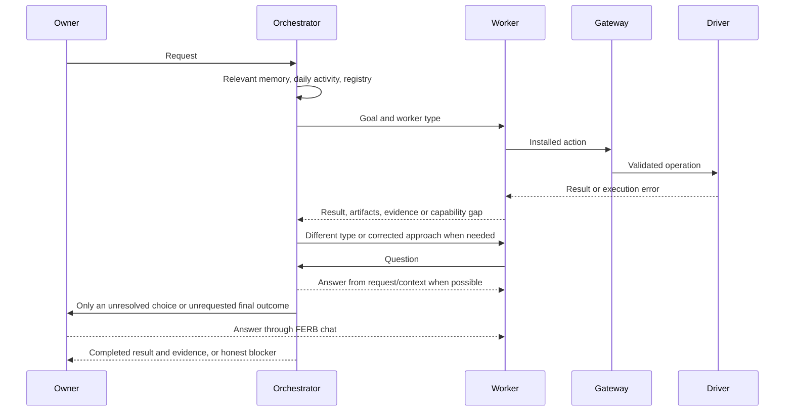

# FERB code tour — 0.22.0

Start with [the current contract](docs/ORCHESTRATED_CONTROL_022.md). This tour follows the live execution path;
older pure policy helpers remain disconnected. `vibed/` is abandoned and must not be read or reused.

## 0. Types and registry

`ferb/core/types.py` holds tasks, outcomes, tool context, targets, browser references and action results.
`core/interfaces.py` defines capabilities, runtimes, clocks and drivers. `registry.py:build` registers tools and
runtime adapters explicitly; daemon builders add browser, Mac, shell, time and trail capabilities.
`act/catalog.py:ActionsSearch` exposes bounded searches over the installed action registry. Scope names identify
capability transport access. Normal task workers receive all registered scopes, across account families.

## 1. Chat, work and recovery

`cli/chat.py` connects to `Daemon._chat_send`; the daemon keeps a task running when the CLI disconnects.
`Supervisor.send` records the owner's message, recalls memory and restores durable conversation context from
`Continuity`. `_supervise` adds relevant activity/registry matches and current environment facts. The model returns
`SupervisorOutcome`: reply, clarify or task, with optional task control, memory, reminder or schedule requests.
Control IDs are validated against the conversation, so fabricated/cross-conversation IDs cannot stop another task.

`run_tree` creates the root and worker records and assigns all installed capability scopes. `_context` includes the
owner's actual instructions, relevant memory/activity, recent reports, artifacts and unknown prior actions. `_worker`
uses `WorkerRuns.run_worker` to invoke one attempt. A failed/blocked report goes to `_dispatch` with
`prompts/dispatch.md`; its typed response selects a worker type, correction, owner question or final blocker.

`WorkerRuns._run_worker_once` creates/revokes the run token and traces the attempt. `_run` tracks/cancels model runs;
`_watch` checks silence, not action counts. `guards.py:Activity` pauses liveness timing while waiting for the owner.
No fixed tree duration, action count, attempt count or Claude turn cap remains in this path.

`Gateway._call` checks task/token/capability/arguments, describes the action for tracing and locks resources.
`_execute` records ledger intent, invokes the tool, stores done/failed/unknown, redacts output and emits
`action.observed`. It never invokes the legacy `PolicyEngine.evaluate`. `effect`/`why` are annotations. Reading
external content records provenance without withdrawing tools. Account-family tool context is retained.

## 2. Mac actions

`act/mac/tools.py` translates tool inputs to `MacComputerDriver` operations. `accessibility.py` reads fresh window
and control state. Driver methods prefer Accessibility and app-directed background routes, recording observed
success/failure in `profile.py`. They retain valid references, correct windows, privacy exclusions and password-field
handling. They do not infer permission from app names, labels or keyboard words.

`screenshot.py` captures one window in memory. `pointer_at` binds image coordinates to that window, using the optional
window-targeted backend where available. `input.py` posts gestures under the input lock and releases buttons on
cancellation. `mac.pointer action=scroll` uses wheel input; distance and batch count are model-selected.
`_scroll` handles native semantic scrolling, container targeting and progress. See `docs/BACKGROUND_SCROLL_021.md`
for transport constraints and the precise scope of previous owner verification.

## 3. Browser actions

`act/browser/tools.py` exposes `browser.*` and `ferb_browser.*`. `ext_bridge.py:Router` resolves paired owner profiles;
FERB's identity driver serves its profile. A task worker can use either family as the request requires. FERB's
profile default and personal-profile selection are prompt decisions, not scope deletion or special wording tests.

The native host/extension use authenticated messages and sequence numbers. `ext_bridge.py` manages task-tab aliases,
windowless profile wake, debugger sessions, snapshots, exact references and cleanup. The extension uses Accessibility
roles and DOM-backed targets, CDP input and frame-aware screenshot coordinates. A fresh visual gesture consumes its
snapshot. `browser_find` and `browser_scroll` inspect large/lazy-loaded pages; the agent verifies actual content.

`Daemon._browser_read_parent` validates registered checker access to its worker's tab. `owned_by(..., read_only=True)`
borrows that alias for inspection; other task tabs remain isolated and borrowed tabs cannot be edited or closed.
`Daemon._browser_context` supplies existing aliases to the checker. No automatic account-helper page is opened
before a click. Explicit account inspection and sealed secret/login-code tools remain available.

## 4. Questions and authorization

`act/ask.py:OwnerAsk` is handled by `Gateway._ask_owner`. It first calls `Supervisor.route_question` using
`prompts/question.md`. The orchestrator answers from the request when possible. Otherwise `Approvals.question` and
`approval.requested` transport the choice to the normal CLI/voice interface; these are question transport, not the
removed action-permission engine. `chat.answer` resolves it and the worker continues. Scheduled runs cannot wait
on an absent owner. `Gateway.ask_login_code` uses hidden owner input without exposing the OTP to the model.

## 5. Results and uncertainty

`verify.py:Checks` handles observable file/driver checks. `Supervisor.verify` sends judgment or inconclusive checks
to `_verifier`. `VerifierResult.met` accepts true, false or null. `_worker` returns false checks to orchestrator
recovery; null is reported honestly. `_final` produces the answer and evidence.

`ledger.py` records consequential execution before input. A lost acknowledgement or restart yields unknown;
`_context` passes unknown actions from this attempt and its prior durable attempt to the agent for inspection.
No automatic “unknown means refuse the whole retry” branch remains. Browser transport still reconciles delivery
of individual command IDs without blindly replaying them.

## 6. Schedules and time

`schedules.py` persists recurring rules; `clock/when.py` resolves structured dates, time zones and relative times.
`Daemon._schedule_create` records the owner's original request and future run; `Supervisor.run_scheduled` invokes
the same orchestrator/worker path. Recorded targets are context, not a hard permission ceiling. Timers, reminders
and schedule management remain in the CLI and journal. Question routing can answer from context during unattended
runs; a necessary owner answer is reported as missing.

## 7. Activity and memory

`sense/trail.py:Trail.record` applies pause/exclusions, redacts and attributes an observation, persists it and emits
`trail.event`. Watchers cover app focus, window/tab metadata, idle state and selected file events.
`Daemon._publish` mirrors trail/action events to `sense/daily.py:DailyActivity`. `today.jsonl` resets on its first
access after the local date changes. `search` streams valid rows and returns bounded keyword/recency matches.

`Daemon._relevant_context` retrieves daily activity and registry matches. `Supervisor` separately recalls relevant
memory for each turn and worker continuation. External observations/reports are wrapped as data. Existing memory
modules handle owner-stated facts, proposed memories, provenance, retrieval, retraction and exports. The daily log
is separate from longer-term memory and SQLite audit retention.

## 8. Setup and voice

`cli/setup.py:setup` installs/scans, collects the setup permissions and offers app Automation before the self-test.
The update path uses `setup.permissions_version` so upgrading to 0.22 offers permission collection once. The
installed daemon remains separate from the development checkout. FERB.app handles microphone/speech permission;
`voice/controller.py` connects transcription/replies and question answers to the daemon's chat path.

## 9. Testing and measurement

Run `.venv/bin/python -m pytest -q` and `.venv/bin/python -m mypy ferb/core`. The new orchestration contract is in
`tests/test_orchestrated_control.py`; daily context in `test_daily_activity.py`; setup migration in
`test_setup_flow.py`. Driver, token, stop, ownership and secret tests remain. Retired gate assertions are listed in
`docs/TEST_MIGRATION_022.md`; pure legacy-policy tests do not describe current authorization behavior.

Use `ferb stats` for recorded outcomes and `ferb trace` for a concrete attempt. Owner-supervised live acceptance
checks actual task results and disturbance, separately from detector/driver claims. Installation and live acceptance
of 0.22 remain pending. Do not run old live policy-gate scenarios as current behavior without updating their expectations.
